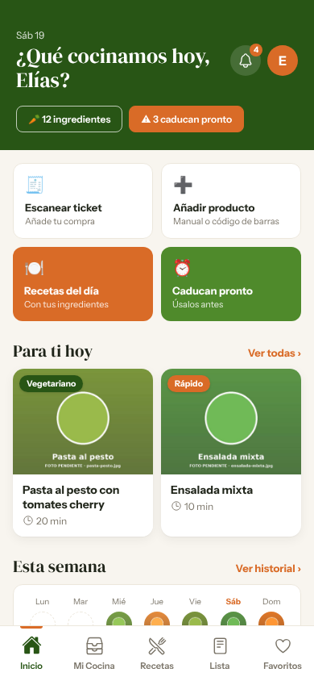
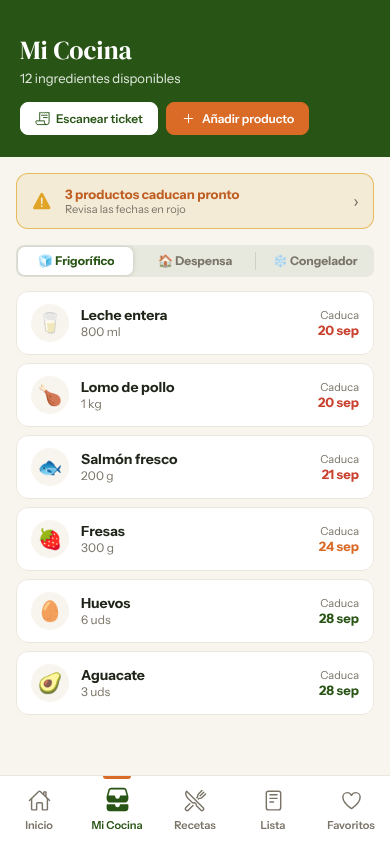
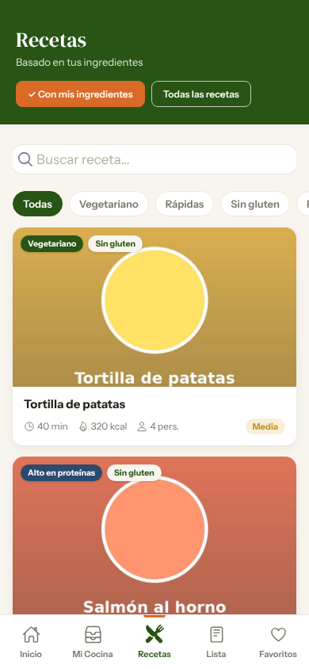
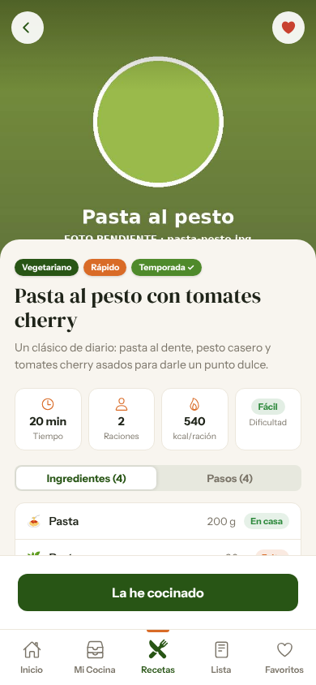

# SmartChef 🍳

**Come mejor, gasta menos.** SmartChef es una app para organizar la comida de casa: sabe qué tienes en la nevera y la despensa, te avisa antes de que algo caduque, te propone recetas con lo que ya tienes, prepara tu lista de la compra y guarda un historial de lo que cocinas.

Es el proyecto integrado de 2º de **Desarrollo de Aplicaciones Multiplataforma (DAM)** en SAFA Nuestra Señora de los Reyes (Sevilla), y reúne los módulos de Acceso a Datos y Desarrollo de Interfaces.

<p align="center">
  
  
  
  
</p>

## Tecnologías

| Parte | Stack |
|---|---|
| **Backend** (raíz del repo) | Java 25 · Spring Boot 4 · Spring Data JPA / Hibernate · PostgreSQL · Lombok · Maven |
| **App** (`app/`) | Angular 22 · Ionic 9 · Capacitor 8 (Android) · TypeScript · SCSS |
| **Pruebas** | JUnit 5 · `@DataJpaTest` |

## Qué incluye

**Backend: capa de acceso a datos**
- 12 entidades JPA mapeadas sobre el esquema `smartchef` de PostgreSQL: recetas, ingredientes, pasos, usuarios, despensa, colecciones, notificaciones…
- Claves compuestas con `@EmbeddedId` y `@MapsId` para las tablas intermedias con datos propios (receta-ingrediente, despensa).
- Todas las relaciones con carga `LAZY`, y consultas `JOIN FETCH` para traer lo necesario sin caer en el problema N+1.
- 10 repositorios con consultas derivadas, JPQL, consultas nativas y operaciones `@Modifying` con `@Transactional`.
- Tests de repositorio con `@DataJpaTest` y un `CommandLineRunner` que comprueba la persistencia al arrancar.
- El esquema se valida al iniciar (`ddl-auto=validate`) y las credenciales van en variables de entorno, no en el código.

**App: interfaz móvil**
- Más de 15 pantallas: entrada, login, registro, inicio, mi cocina, añadir producto, escanear ticket, recetas, ficha de receta, favoritos, colecciones, lista de la compra, historial, notificaciones y perfil.
- Componentes standalone reutilizables (tarjetas de receta, chips, filas de producto, estados vacíos…).
- Modo claro y oscuro.
- Por ahora funciona con datos de maqueta. El siguiente paso es conectarla con la API de Spring Boot.

Las capturas de todas las pantallas están en el [README de la app](app/README.md).

## Cómo ejecutarlo

### Backend

Necesitas Java 25 y una base de datos PostgreSQL con el esquema `smartchef` creado. Configura la conexión con variables de entorno:

```bash
export DB_URL=jdbc:postgresql://localhost:5432/tu_base_de_datos
export DB_USER=tu_usuario
export DB_PASSWORD=tu_contraseña
export SCHEMA=smartchef

./mvnw spring-boot:run      # en Windows: mvnw.cmd spring-boot:run
./mvnw test                 # ejecutar los tests
```

### App

```bash
cd app
npm install
ionic serve                 # o npm start → http://localhost:4200
```

Para Android: `ionic build`, `npx cap sync` y `npx cap run android`.

## Estado del proyecto

🚧 En desarrollo, durante el curso 2026-2027.

- [x] Modelo de datos y repositorios JPA
- [x] Interfaz de la app con todas las pantallas
- [ ] DTOs y mappers para que la API devuelva datos y no entidades
- [ ] API REST y conexión de la app con el backend

## Autor

**Elías Ponce Casín**: estudiante de DAM en Sevilla.
[LinkedIn](https://www.linkedin.com/in/el%C3%ADas-ponce-cas%C3%ADn-32b9932b0) · [GitHub](https://github.com/casin75)
